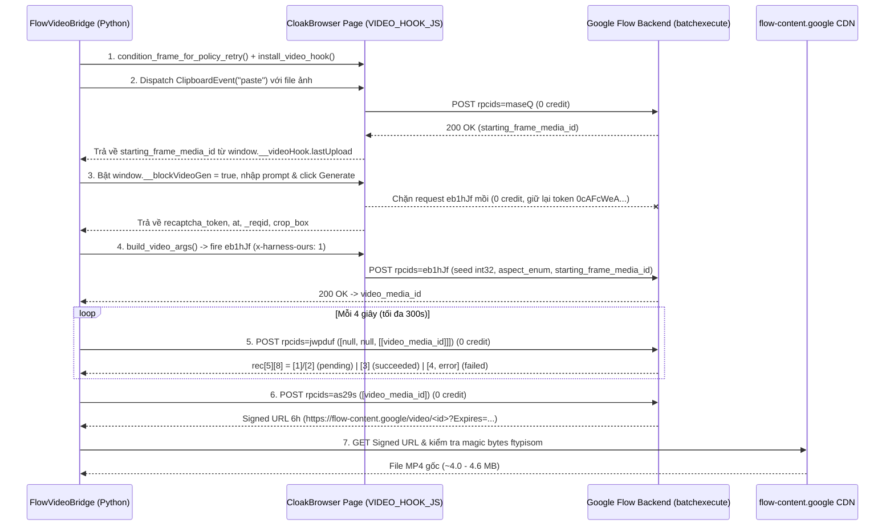

# Flow Video Generation (`eb1hJf` + `jwpduf` + `as29s` + `maseQ`) — Đặc tả Giao thức (Bridge Mode)

> **Nguồn bằng chứng (Observed):**
> - Capture 0-credit trực tiếp trên CloakBrowser CDP (`127.0.0.1:4023`) ngày 2026-10-26 trên dự án `006f6e93-2d22-4a3d-9b03-1a902a50fd10`.
> - Đối chiếu vi sai (Differential Analysis) giữa 2 lần capture `eb1hJf` ở tỷ lệ `9:16` (Portrait) và `16:9` (Landscape).
> - Đối chiếu trạng thái `jwpduf` giữa job thành công (`4bc92435-2cfc-4ffb-a324-bc4881f7ebce`) và job bị bộ lọc từ chối (`2686a0ae-5f6c-4526-9005-3d0a14283a4c`).
> - Kiểm chứng tải luồng video gốc qua signed CDN URL của `as29s` (`4,594,409` bytes, magic `ftypisom`).

---

## 1. Kiến trúc Tổng quan: So sánh Tạo Ảnh (`ogiZ0b`) vs Tạo Video (`eb1hJf`)

Khác với tạo ảnh (`ogiZ0b` giữ kết nối HTTP long-poll ~18–24s rồi trả thẳng ảnh trong 1 response), tạo video trên Google Flow (Veo / `abra_i2v_8s`) mất ~45–120s render nên được thiết kế theo **kiến trúc bất đồng bộ 4 RPC** trên cùng endpoint `/_/AiSandboxAngularFrontend/data/batchexecute`:

| Bước | RPC ID | Chi phí Credit | Vai trò |
| :--- | :--- | :--- | :--- |
| **1. Upload Starting Frame** | **`maseQ`** | **0 credit** | Tải ảnh khung hình đầu (`base64`) lên dự án, trả về `MediaItem` chứa `starting_frame_media_id` (UUIDv4). Tự động kích hoạt khi bắn sự kiện `ClipboardEvent('paste')` vào `div.ProseMirror`. |
| **2. Submit Video Job** | **`eb1hJf`** | **~1–2 credit** (0 nếu chặn/reject) | Gửi yêu cầu render video (`abra_i2v_8s`) kèm `starting_frame_media_id`, `prompt`, `aspect_enum`, `seed`, và token reCAPTCHA Enterprise (`0cAFcWeA...`). Phản hồi tức thì (<1s) trả về `video_media_id`. |
| **3. Poll Render Status** | **`jwpduf`** | **0 credit** | Truy vấn trạng thái render của `[video_media_id]` mỗi ~4s. Trả về trạng thái chính xác (`1` = hoàn tất, `4` = lỗi kèm mã lỗi chi tiết như `PUBLIC_ERROR_PROMINENT_PEOPLE_FILTER_FAILED`). |
| **4. Mint Signed Video URL** | **`as29s`** | **0 credit** | Đổi `video_media_id` đã hoàn tất sang **Signed CDN URL hiệu lực 6 giờ** (`https://flow-content.google/video/<video_media_id>?Expires=...&KeyName=labs-flow-prod-cdn-key&Signature=...`) để tải file MP4 gốc (`ftypisom`) không cần cookie. |

---

## 2. Đặc tả Chi tiết từng RPC

### 2.1 RPC `maseQ` — Tải ảnh Starting Frame lên Dự án (0 credit)

Khi đính kèm file ảnh vào composer (có thể kích hoạt hoàn toàn bằng JS thông qua `new ClipboardEvent('paste', {clipboardData: dt})` trên `div.ProseMirror` mà không cần mở menu UI), ứng dụng tự xin token reCAPTCHA và gọi `maseQ`:

**Query params:** `rpcids=maseQ&source-path=%2Fproject%2F<project_id>&...`

**Cấu trúc `args` (Observed):**
```json
[
  [
    null,
    22,
    null,
    null,
    null,
    "<project_id>",
    null,
    null,
    null,
    null,
    [
      "<recaptcha_token_0cAFcWeA...>",
      1
    ]
  ],
  "<base64_encoded_image_bytes>",
  "image/png",
  1,
  null,
  null,
  null,
  null,
  "first_frame.png",
  null,
  "<UUID_1_UPPERCASE>",
  "<UUID_2_UPPERCASE>"
]
```

**Response `wrb.fr` của `maseQ` (Observed):**
```json
[
  [
    "fd919f1d-8086-4b31-991e-63cfe5503b99",
    "006f6e93-2d22-4a3d-9b03-1a902a50fd10",
    "879701be-2592-4337-9f9a-f7815477e798",
    null,
    null,
    [[1793010070, 669762000], null, null, null, null, null, [null, null, null, null, 1], null, null, 1, null, null, null, 115107],
    [null, [null, null, null, null, 0, null, "image/png"], [1536, 2752], null, null, [null, null]]
  ]
]
```
- `data[0][0]`: `starting_frame_media_id` (`"fd919f1d-8086-4b31-991e-63cfe5503b99"`).
- `data[0][1]`: `project_id`.
- `data[0][2]`: `item_id`.
- `data[0][6][2]`: `[width, height]` của ảnh.

---

### 2.2 RPC `eb1hJf` — Khởi tạo Yêu cầu Render Video (Submit Video Generation)

**Query params:** `rpcids=eb1hJf&source-path=%2Fproject%2F<project_id>&bl=...&f.sid=...&hl=vi&_reqid=<reqid>&rt=c`

**Cấu trúc `args` (Observed — Differential Analysis `9:16` vs `16:9`):**
```json
[
  [
    [
      [
        null,
        null,
        [
          [
            [
              "<prompt_text>"
            ]
          ]
        ]
      ],
      "abra_i2v_8s",
      1,
      null,
      [
        null,
        "e82f17d3-6a15-4a0b-bacb-8c9054fb79ab",
        null,
        null,
        null,
        [
          0.003875968992248069,
          null,
          0.9961240310077519,
          1
        ]
      ],
      [
        null,
        null,
        null,
        null,
        "714A724A-2DC1-4CB1-A561-4235DCA2F986",
        "2C4B05EC-E027-426D-A403-B13097336CF5"
      ]
    ]
  ],
  [
    null,
    22,
    null,
    null,
    null,
    "006f6e93-2d22-4a3d-9b03-1a902a50fd10",
    null,
    null,
    null,
    null,
    [
      "0cAFcWeA...",
      1
    ]
  ],
  [
    "152B3C04-BCDF-40EA-A3CA-215E0F90438F",
    2
  ]
]
```

#### Bảng giải nghĩa từng vị trí trong `args` của `eb1hJf`:

| Đường dẫn JSON | Kiểu | Giá trị quan sát | Ý nghĩa & Quy tắc |
| :--- | :--- | :--- | :--- |
| `args[0][0][0]` | `list` | `[null, null, [[["<prompt>"]]]]` | Prompt mô tả chuyển động video (bọc 3 lớp mảng trong vị trí `[2]`). |
| `args[0][0][1]` | `str` | `"abra_i2v_8s"` | Mã model tạo video 8 giây từ khung hình đầu (`abra_i2v_8s`). |
| `args[0][0][2]` | `int` | `1` hoặc `2` | **Tỷ lệ khung hình (`aspect_enum`)**: `1` = **9:16 (Dọc / Portrait)**, `2` = **16:9 (Ngang / Landscape)**. |
| `args[0][0][3]` | `int \| null` | `null` hoặc `int32` (`1..2147483647`) | Seed tạo video. Khi để `null`, server tự sinh seed `int32` và trả về tại `rec[7][0][1]`. |
| `args[0][0][4]` | `list` | `[null, "<media_id>", null, null, null, [x0, null, x1, 1]]` | Tham chiếu **Starting Frame**: vị trí `[1]` là `starting_frame_media_id`, vị trí `[5]` là khung crop chuẩn hóa `[x0, y0, x1, y1]`. |
| `args[0][0][5]` | `list` | `[null, null, null, null, "<UUID_1>", "<UUID_2>"]` | Hai UUIDv4 viết HOA định danh request client. |
| `args[1]` | `list` | `[null, 22, null, null, null, "<project_id>", null, null, null, null, ["<token>", 1]]` | Khối `ref` (giống hệt `ogiZ0b`): `ref[5]` là `project_id` (viết thường), `ref[10][0]` là **reCAPTCHA Enterprise token** (`0cAFcWeA...`, ~2500 ký tự). |
| `args[2]` | `list` | `["<GEN_ID_UUID>", 2]` | `gen_id` (UUIDv4 viết HOA) kèm cờ `2` (video batch mode). |

---

### 2.3 RPC `jwpduf` — Kiểm tra Trạng thái Render & Bắt lỗi Chính sách (0 credit)

Ngay sau khi `eb1hJf` trả về `video_media_id`, client gọi `jwpduf` định kỳ mỗi ~4 giây để kiểm tra tiến độ render mà không phụ thuộc DOM:

**Cấu trúc `args` (Observed):**
```json
[
  null,
  null,
  [
    [
      "<video_media_id>"
    ]
  ]
]
```

**Cấu trúc `data` phản hồi của `jwpduf` (Observed):**
`data = [null, 709, [ MediaItem ]]` trong đó `rec = data[2][0]`:
- `rec[0]`: `video_media_id`
- `rec[1]`: `project_id`
- `rec[2]`: `item_id`
- `rec[5]`: `meta_block`:
  - **Trạng thái đang xử lý (`PENDING / RENDERING`)**:
    - `rec[5][8]` = `[1]` hoặc `[2]`
    - `rec[5][9]` = `1` *(Lưu ý quan trọng: `rec[5][9]` đã bằng `1` ngay khi đang render, do đó **không được** dùng `rec[5][9] == 1` làm điều kiện hoàn tất mà phải kiểm tra `rec[5][8][0] == 3`)*.
    - `rec[5][13]` = `null` (chưa có file MP4).
  - **Trạng thái hoàn tất (`SUCCEEDED`)**:
    - `rec[5][8]` = `[3]` (`status_detail[0] == 3`)
    - `rec[5][9]` = `1`
    - `rec[5][13]` = kích thước file MP4 tính bằng byte (ví dụ `4606899` hoặc `3983696`).
  - **Trạng thái bị từ chối / lỗi (`FAILED / REJECTED`)**:
    - `rec[5][8]` = `[4, [3, "PUBLIC_ERROR_PROMINENT_PEOPLE_FILTER_FAILED"], ["PROMINENT_PERSON"]]` (`status_detail[0] == 4`)
    - `rec[5][9]` = `4`
    - Mã lỗi máy đọc được nằm tại `rec[5][8][1][1]`, danh mục lỗi tại `rec[5][8][2]`.
- `rec[7]`: `video_block`:
  - `rec[7][0][1]`: `seed_echo` (ví dụ `285530228` hoặc `207487042`).
  - `rec[7][0][12]`: `"abra_i2v_8s"`.
  - `rec[7][1]`: `[null, null, [8]]` (thời lượng 8 giây).

---

### 2.4 RPC `as29s` — Lấy Signed CDN URL 6 Giờ cho File Video Gốc (0 credit)

Khi `jwpduf` báo `rec[5][8] == [3]` (hoàn tất), gọi `as29s` để lấy URL tải trực tiếp file MP4 chất lượng gốc từ CDN `flow-content.google`:

**Cấu trúc `args` (Observed):**
```json
[
  "<video_media_id>"
]
```

**Cấu trúc `data` phản hồi của `as29s` (Observed):**
- `data[7][0][8]` và `data[7][5][1][0]`:
  ```text
  https://flow-content.google/video/<video_media_id>?Expires=1793031563&KeyName=labs-flow-prod-cdn-key&Signature=-T-d1bG8rxAROHIn34tqsng8098
  ```
  - Đây là **Signed URL 6 giờ**, tải trực tiếp qua HTTP `GET` (không cần cookie), trả về `Content-Type: video/mp4`, magic bytes `\x00\x00\x00 ftypisom` (dung lượng đầy đủ ~4.0–4.6 MB cho video 8s, cao hơn hẳn bản preview nén 1.9 MB trên thẻ `<video>` DOM `=mm,22,15`).
- **Fallback URL (`Zzl0ze` / FIFE stream):** Nếu cần tải qua URL `https://lh3.googleusercontent.com/asb/<token>` hoặc `https://flow.google.com/asb/<token>`, phải nối hậu tố FIFE **`=mm,22,15`** và gửi kèm cookie phiên (`context.request.get`).

---

## 3. Lưu đồ Tuần tự Bridge Mode cho Video (`FlowVideoBridge`)



---

## 4. Cơ chế Phòng chống & Tự phục hồi Lỗi `PUBLIC_ERROR_PROMINENT_PEOPLE_FILTER_FAILED`

Trong chế độ **Khung hình (`abra_i2v_8s`)**, Google Flow quét đồng thời cả **ảnh Starting Frame** lẫn **Prompt văn bản** qua bộ lọc nhận diện người nổi tiếng (`PROMINENT_PERSON`). Để triệt tiêu lỗi dương tính giả trên ảnh người mẫu thời trang châu Á:

1. **Tầng 1 — Vi chỉnh ảnh đầu vào (`condition_frame_for_policy_retry`)**:
   - Dùng FFmpeg cắt viền trung tâm 1.5% (`crop=iw*0.97:ih*0.97:iw*0.015:ih*0.015,scale=iw:ih`) kết hợp dịch nhẹ độ sáng/tương phản/bão hòa (`eq=brightness=0.012:contrast=0.985:saturation=0.98`).
   - Mắt thường không phân biệt được sự khác biệt và giữ nguyên 100% form dáng trang phục, nhưng vector embedding khuôn mặt dịch chuyển đủ để không vượt ngưỡng khớp nhầm người nổi tiếng.
2. **Tầng 2 — Làm sạch Prompt (`sanitize_video_prompt`)**:
   - Loại bỏ các cụm từ ép khóa danh tính như `"exact young Korean woman from the reference image"`, `"strictly lock facial identity"`, `"visible skin micro-pores"`, cùng các nhãn phân đoạn `- 0s to 2s (...):` và khối `Camera & Realism:` ở cuối câu lệnh.
3. **Tầng 3 — Phát hiện sớm qua `jwpduf` (~4–8s) & Retry tự động**:
   - Nếu Lượt 1 vẫn gặp `rec[5][8][0] == 4` (`PUBLIC_ERROR_PROMINENT_PEOPLE_FILTER_FAILED`), `FlowVideoBridge` phát hiện ngay sau 4–8 giây, tự động dọn thẻ lỗi trên DOM, vi chỉnh thêm 1 lớp ảnh + bật `aggressive=True` + đổi `seed` `int32` mới và bắn lại Lượt 2.

---

## 5. Bảng Ánh xạ Hàm Thực thi trong [`src/Bridge/flow_video_bridge.py`](file:///D:/Dev/rev-flow/src/Bridge/flow_video_bridge.py)

| Hàm / Phương thức | Vai trò |
| :--- | :--- |
| `VIDEO_HOOK_JS` | Hook `window.fetch` in-page: chặn `eb1hJf` mồi của app (0 credit) và bắt ngầm response `maseQ` khi paste ảnh. |
| `parse_video_app_capture(body)` | Giải mã `f.req` và `at` từ request mồi, trích xuất `recaptcha_token` tại `args[1][10][0]`. |
| `build_video_args(...)` | Đóng gói `args` tất định cho `eb1hJf` (`abra_i2v_8s`, `aspect_enum` `1`/`2`, `seed` `int32`, `starting_frame_media_id`, UUID viết hoa). |
| `build_jwpduf_args(video_media_id)` | Đóng gói `[None, None, [[video_media_id]]]` để poll trạng thái render (0 credit). |
| `parse_jwpduf_status(data)` | Phân tích `rec[5][8]` (`[1]/[2]` = `pending`, `[3]` = `succeeded`, `[4, ...]` = `failed` kèm `error_code` & `error_categories`). |
| `build_as29s_args(media_id)` | Đóng gói `[media_id]` để mint Signed Video CDN URL 6 giờ (0 credit). |
| `extract_signed_video_url(data)` | Ưu tiên lấy URL `https://flow-content.google/video/<id>?Expires=...` từ `as29s`, fallback sang FIFE `=mm,22,15`. |
| `condition_frame_for_policy_retry(...)` | Vi chỉnh nhẹ ảnh khung hình đầu bằng FFmpeg để vượt bộ lọc `PROMINENT_PERSON`. |
| `FlowVideoBridge.generate_video_flow(...)` | Pipeline thực thi trọn gói: `maseQ` → `eb1hJf` → `jwpduf` → `as29s` → `download_video_verified`. |

---

## 6. Biên bản Kiểm chứng Thực tế (Live E2E Receipt — 2026-10-26)

Kiểm chứng trực tiếp trên dự án `006f6e93-2d22-4a3d-9b03-1a902a50fd10` (`http://127.0.0.1:4023`) với tấm ảnh mẫu từng bị lỗi `PUBLIC_ERROR_PROMINENT_PEOPLE_FILTER_FAILED`:

| Giai đoạn | `video_media_id` | `seed` | Kết quả `jwpduf` | Dung lượng MP4 (`as29s`) |
| :--- | :--- | :--- | :--- | :--- |
| **Video 1 — Lượt 1** *(ảnh gốc chưa vi chỉnh)* | `cb32e540-9263-403c-9735-d75baca23a66` | `1152294038` | Phát hiện `PUBLIC_ERROR_PROMINENT_PEOPLE_FILTER_FAILED` sau **4s** | *(Tự động kích hoạt Retry)* |
| **Video 1 — Lượt 2** *(sau `condition_frame` + `sanitize`)* | `29a57c63-3425-4355-aa47-ef4c72de010a` | `285530228` | `state=succeeded` (`rec[5][8]=[3]`) | **`4,606,899 bytes`** (`video_1_8s.mp4`) |
| **Video 2 (8–16s)** *(từ Last Frame đã vi chỉnh)* | `7d2fdff5-3ab5-40e9-b41f-e2fddd901301` | `207487042` | `state=succeeded` ngay Lượt 1 sau **34s** | **`3,983,696 bytes`** (`video_2_8s.mp4`) |
| **Ghép nối 16s (FFmpeg)** | — | — | Hoàn tất `concatenate_two_videos` | **`4,252,624 bytes`** (`final_tryon_video_16s.mp4`) |

