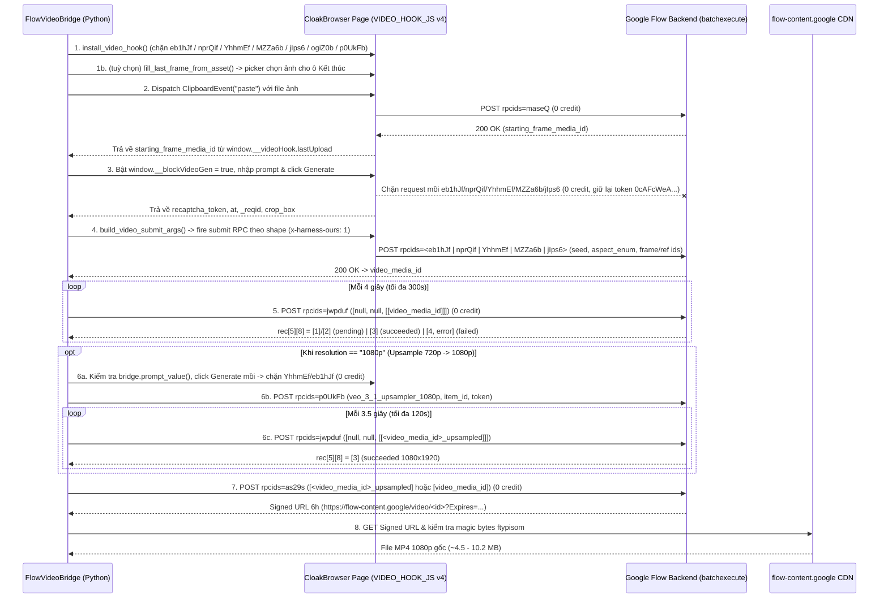

# Flow Video Generation — Đặc tả Giao thức (Bridge Mode)

> **Nguồn bằng chứng (Observed):**
> - Capture 0-credit trực tiếp trên CloakBrowser CDP (`127.0.0.1:4023`) ngày 2026-10-26 trên dự án `006f6e93-2d22-4a3d-9b03-1a902a50fd10`.
> - Đối chiếu vi sai (Differential Analysis) giữa 2 lần capture `eb1hJf` ở tỷ lệ `9:16` (Portrait) và `16:9` (Landscape).
> - Đối chiếu trạng thái `jwpduf` giữa job thành công (`4bc92435-2cfc-4ffb-a324-bc4881f7ebce`) và job bị bộ lọc từ chối (`2686a0ae-5f6c-4526-9005-3d0a14283a4c`).
> - Kiểm chứng tải luồng video gốc qua signed CDN URL của `as29s` (`4,594,409` bytes, magic `ftypisom`).
> - **Cập nhật Omni 1.2 Flash (2026-11-09)** — capture 0-credit trên profile `flow_main`, dự án `01c4173f-a60e-449d-89be-24acde56d034`:
>   `traces/submit_bodies/omni12_*` + `traces/video_model_matrix.json`. Mọi kết luận dưới đây về
>   model key / duration / 2 khung hình / tham chiếu video đều lấy từ đó.

---

## 0. Thay đổi phá vỡ tương thích của Omni 1.2 Flash (đọc trước)

Google Flow đã thay model video mặc định `Omni 1.1 Flash` (`abra_*`) bằng **`Omni 1.2 Flash`**
(`macaron_cookie_*`), và kèm theo là 4 thay đổi giao thức. **Omni 1.1 Flash, Veo 3.1 - Fast và
Veo 3.1 - Quality đã bị Flow tách khỏi app** (menu model ngày 2026-11-09 chỉ còn `Omni 1.2 Flash`
+ `Veo 3.1 - Lite`), nên catalog của app chỉ còn cung cấp hai model đó:

| # | Trước (Omni 1.1) | Nay (Omni 1.2) |
| :--- | :--- | :--- |
| 1 | `abra_i2v_8s` / `abra_t2v_8s` | `macaron_cookie_i2v_8s` / `macaron_cookie_t2v_8s` |
| 2 | Thời lượng là **radio 4/6/8/10 giây**, duration nằm trong key | **Slider `Độ dài` 3..15 giây**, duration vẫn nằm trong key (mọi giá trị nguyên) |
| 3 | "Khung hình" chỉ có 1 ô `Bắt đầu` | **2 ô: `Bắt đầu` + `Kết thúc`**; điền ô thứ hai đổi RPC sang `nprQif` |
| 4 | "Thành phần" chỉ nhận ảnh tham chiếu | Nhận **cả video tham chiếu** (`jIps6`, model key `abra_edit`) |

Ba model đã ngừng cung cấp — `omni_1_1_flash`, `veo_3_1_fast`, `veo_3_1_quality` — vẫn được
`resolve_video_model()` ánh xạ về `omni_1_2_flash`, vì canvas lưu trước đó còn tên chúng; đây là
ánh xạ **một chiều**, không đường nào resolve ngược về model đã bỏ.

Hai giới hạn duration đã đo trực tiếp từ `flow-duration-slider`:

| Trạng thái composer | `input[type=range]` | Suy ra | Ghi chú |
| :--- | :--- | :--- | :--- |
| Không/1 khung hình, hoặc "Thành phần" | `min=0, max=12` | **3..15 giây** | đúng mô tả "min 3s, max 15s" |
| **Có cả 2 khung hình** (`Bắt đầu` + `Kết thúc`) | `min=0, max=7` | **3..10 giây** | Flow tự hạ trần khi gắn khung cuối |

`giá trị slider = số giây − 3`. Offset này được đọc từ DOM (`aria-valuetext` so với label
`Độ dài N giây`) chứ không hard-code, để nếu Flow đổi cách đánh số thì vẫn đặt đúng.

---

## 1. Kiến trúc Tổng quan: So sánh Tạo Ảnh (`ogiZ0b`) vs Tạo Video

Khác với tạo ảnh (`ogiZ0b` giữ kết nối HTTP long-poll ~18–24s rồi trả thẳng ảnh trong 1 response), tạo video trên Google Flow mất ~45–120s render nên được thiết kế theo **kiến trúc bất đồng bộ 4 RPC** trên cùng endpoint `/_/AiSandboxAngularFrontend/data/batchexecute`:

| Bước | RPC ID | Chi phí Credit | Vai trò |
| :--- | :--- | :--- | :--- |
| **1. Upload khung hình** | **`maseQ`** | **0 credit** | Tải ảnh khung hình (`base64`) lên dự án, trả về `MediaItem` chứa `media_id` (UUIDv4). Tự động kích hoạt khi bắn sự kiện `ClipboardEvent('paste')` vào `div.ProseMirror`. |
| **2. Submit Video Job** | `eb1hJf` / `nprQif` / `YhhmEf` / `MZZa6b` / `jIps6` | **~1–2 credit** (0 nếu chặn/reject) | Gửi yêu cầu render kèm frame id, `prompt`, `aspect_enum`, `seed`, và token reCAPTCHA Enterprise. **RPC nào được bắn là do trạng thái composer quyết định** (xem §2). |
| **3. Poll Render Status** | **`jwpduf`** | **0 credit** | Truy vấn trạng thái render của `[video_media_id]` (hoặc `[<video_media_id>_upsampled]`) mỗi ~4s. `rec[5][8]=[3]` = hoàn tất, `[4, ...]` = lỗi kèm mã lỗi chi tiết. |
| **4. Upsample 720p → 1080p** | **`p0UkFb`** | **0 credit** *(trên gói Pro)* | Kích hoạt model `"veo_3_1_upsampler_1080p"` để nâng video gốc 720p lên **1080p** với ID tất định `<video_media_id>_upsampled`. |
| **5. Mint Signed Video URL** | **`as29s`** | **0 credit** | Đổi media id đã hoàn tất sang **Signed CDN URL hiệu lực 6 giờ** (`https://flow-content.google/video/<id>?Expires=...`) để tải MP4 gốc (`ftypisom`) không cần cookie. |

---

### 2.0 Bảng chọn RPC Submit theo trạng thái Composer (Observed 2026-11-09)

Đây là bảng quan trọng nhất của đặc tả: **cùng một sub-mode UI có thể bắn RPC khác nhau**, tuỳ
vào ô nào đã có ảnh và tham chiếu là ảnh hay video. Mỗi dòng đã được capture 0-credit.

| Sub-mode UI | Trạng thái | RPC | Model key | Độ dài spec | Trace |
| :--- | :--- | :--- | :--- | :--- | :--- |
| Khung hình | chỉ có `Bắt đầu` | **`eb1hJf`** | `macaron_cookie_i2v_<n>s` | 6 (360p: 10) | `omni12_3s_summary.json` |
| Khung hình | `Bắt đầu` + `Kết thúc` | **`nprQif`** | `macaron_cookie_i2v_fl_<n>s` | **7 (360p: vẫn 7)** | `omni12_first_last_summary.json` |
| Thành phần | không tham chiếu | **`YhhmEf`** | `macaron_cookie_t2v_<n>s` | 5 (360p: 8) | `omni12_ing_169_5s_summary.json` |
| Thành phần | ≥1 **ảnh** tham chiếu | **`MZZa6b`** | `macaron_cookie_r2v_<n>s` | 6 (360p: 12) | `omni12_ing1ref_MZZa6b_args.json` |
| Thành phần | tham chiếu **video** | **`jIps6`** | **`abra_edit`** | 5 | `omni12_ingvideo_jIps6_args.json` |

Hệ quả cho `VIDEO_HOOK_JS`: phải chặn **cả 5** mã RPC này (cộng `p0UkFb`/`ogiZ0b`) — chặn
mỗi `eb1hJf` sẽ để lọt request thật khi composer ở trạng thái 2 khung hình/tham chiếu video,
tức là **tốn credit thật**.

---

## 2. Đặc tả Chi tiết từng RPC

### 2.1 RPC `maseQ` — Tải ảnh khung hình lên Dự án (0 credit)

Khi đính kèm file ảnh vào composer (có thể kích hoạt hoàn toàn bằng JS thông qua `new ClipboardEvent('paste', {clipboardData: dt})` trên `div.ProseMirror` mà không cần mở menu UI), ứng dụng tự xin token reCAPTCHA và gọi `maseQ`:

**Query params:** `rpcids=maseQ&source-path=%2Fproject%2F<project_id>&...`

**Cấu trúc `args` (Observed):**
```json
[
  [
    null,
    22,
    null,
    null,
    null,
    "<project_id>",
    null,
    null,
    null,
    null,
    [
      "<recaptcha_token_0cAFcWeA...>",
      1
    ]
  ],
  "<base64_encoded_image_bytes>",
  "image/png",
  1,
  null,
  null,
  null,
  null,
  "first_frame.png",
  null,
  "<UUID_1_UPPERCASE>",
  "<UUID_2_UPPERCASE>"
]
```

**Response `wrb.fr` của `maseQ` (Observed):**
```json
[
  [
    "fd919f1d-8086-4b31-991e-63cfe5503b99",
    "006f6e93-2d22-4a3d-9b03-1a902a50fd10",
    "879701be-2592-4337-9f9a-f7815477e798",
    null,
    null,
    [[1793010070, 669762000], null, null, null, null, null, [null, null, null, null, 1], null, null, 1, null, null, null, 115107],
    [null, [null, null, null, null, 0, null, "image/png"], [1536, 2752], null, null, [null, null]]
  ]
]
```
- `data[0][0]`: `starting_frame_media_id` (`"fd919f1d-8086-4b31-991e-63cfe5503b99"`).
- `data[0][1]`: `project_id`.
- `data[0][2]`: `item_id`.
- `data[0][6][2]`: `[width, height]` của ảnh.

---

### 2.2 RPC `eb1hJf` — Khởi tạo Yêu cầu Render Video (Submit Video Generation)

**Query params:** `rpcids=eb1hJf&source-path=%2Fproject%2F<project_id>&bl=...&f.sid=...&hl=vi&_reqid=<reqid>&rt=c`

**Cấu trúc `args` (Observed — Differential Analysis `9:16` vs `16:9`):**

> Khối JSON dưới đây là capture ngày 2026-10-26 (thời Omni 1.1) nên `spec[1]` còn là
> `abra_i2v_8s`. **Hình dạng spec không đổi** ở Omni 1.2 — chỉ giá trị model key thành
> `macaron_cookie_i2v_<n>s` (xem bảng giải nghĩa ngay dưới).

```json
[
  [
    [
      [
        null,
        null,
        [
          [
            [
              "<prompt_text>"
            ]
          ]
        ]
      ],
      "abra_i2v_8s",
      1,
      null,
      [
        null,
        "e82f17d3-6a15-4a0b-bacb-8c9054fb79ab",
        null,
        null,
        null,
        [
          0.003875968992248069,
          null,
          0.9961240310077519,
          1
        ]
      ],
      [
        null,
        null,
        null,
        null,
        "714A724A-2DC1-4CB1-A561-4235DCA2F986",
        "2C4B05EC-E027-426D-A403-B13097336CF5"
      ]
    ]
  ],
  [
    null,
    22,
    null,
    null,
    null,
    "006f6e93-2d22-4a3d-9b03-1a902a50fd10",
    null,
    null,
    null,
    null,
    [
      "0cAFcWeA...",
      1
    ]
  ],
  [
    "152B3C04-BCDF-40EA-A3CA-215E0F90438F",
    2
  ]
]
```

#### Bảng giải nghĩa từng vị trí trong `args` của `eb1hJf`:

| Đường dẫn JSON | Kiểu | Giá trị quan sát | Ý nghĩa & Quy tắc |
| :--- | :--- | :--- | :--- |
| `args[0][0][0]` | `list` | `[null, null, [[["<prompt>"]]]]` | Prompt mô tả chuyển động video (bọc 3 lớp mảng trong vị trí `[2]`). |
| `args[0][0][1]` | `str` | `"macaron_cookie_i2v_8s"` | Mã model. Nay là `macaron_cookie_i2v_<n>s` cho **mọi** duration nguyên 3..15 (Omni 1.2 đã bỏ radio 4/6/8/10). |
| `args[0][0][2]` | `int` | `1` hoặc `2` | **Tỷ lệ khung hình (`aspect_enum`)**: `1` = **9:16 (Dọc / Portrait)**, `2` = **16:9 (Ngang / Landscape)**. |
| `args[0][0][3]` | `int \| null` | `null` hoặc `int32` (`1..2147483647`) | Seed tạo video. Khi để `null`, server tự sinh seed `int32` và trả về tại `rec[7][0][1]`. |
| `args[0][0][4]` | `list` | `[null, "<media_id>"]` hoặc `[null, "<media_id>", null, null, null, [x0, y0, x1, y1]]` | Khung **`Bắt đầu`**: vị trí `[1]` là media id, vị trí `[5]` là khung crop chuẩn hóa. **Đuôi crop là trạng thái composer, không phải hằng số**: capture 3s/15s/360p đều chỉ có `[null, id]`, chỉ capture 2 khung mới có crop → builder phải chuyển tiếp `None` thay vì tự điền `DEFAULT_CROP_916/169`. |
| `args[0][0][5]` | `list` | `[null, null, null, null, "<UUID_1>", "<UUID_2>"]` | Hai UUIDv4 viết HOA định danh request client. **Ô này bị chiếm bởi khung `Kết thúc` khi có 2 khung** — xem §2.2b. |
| `args[1]` | `list` | `[null, 22, null, null, null, "<project_id>", null, null, null, null, ["<token>", 1]]` | Khối `ref` (giống hệt `ogiZ0b`): `ref[5]` là `project_id` (viết thường), `ref[10][0]` là **reCAPTCHA Enterprise token** (`0cAFcWeA...`, ~2500 ký tự). |
| `args[2]` | `list` | `["<GEN_ID_UUID>", 2]` | `gen_id` (UUIDv4 viết HOA) kèm cờ `2` (video batch mode). |

---

### 2.2b RPC `nprQif` — Image→Video với **2 khung hình** (`Bắt đầu` + `Kết thúc`)

Khi ô `Kết thúc` có ảnh, Angular **đổi RPC** từ `eb1hJf` sang `nprQif` và spec dài **7** phần tử:
thêm một ô frame trước ô UUID. Capture 0-credit 2026-11-09 (`omni12_first_last_summary.json`):

```json
[
  [
    [
      [null, null, [[["<prompt>"]]]],
      "macaron_cookie_i2v_fl_8s",
      1,
      null,
      [null, "<first_media_id>", null, null, null, [x0, null, x1, 1]],
      [null, "<last_media_id>",  null, null, null, [x0, null, x1, 1]],
      [null, null, null, null, "<UUID_1>", "<UUID_2>"]
    ]
  ],
  [null, 22, null, null, null, "<project_id>", null, null, null, null, ["<token>", 1]],
  ["<GEN_ID_UUID>", 2]
]
```

| Khác biệt so với `eb1hJf` | Giá trị quan sát |
| :--- | :--- |
| Model key | `macaron_cookie_i2v_fl_<n>s` (`fl` = first + last) |
| Độ dài spec | **7** (thay vì 6) |
| `spec[4]` | khung `Bắt đầu` (như cũ) |
| `spec[5]` | **khung `Kết thúc`**, cùng layout `[null, media_id, ..., crop]` |
| `spec[6]` | ô UUID `u1/u2` (dịch từ `spec[5]` xuống) |
| Trần thời lượng | slider hạ từ `max=12` về **`max=7`** ⇒ **3..10 giây** |
| 360p | key `..._360p` nhưng **spec vẫn 7**, KHÔNG có marker `[4]` |

Phát hiện khung cuối: `click` vào `button.empty-chip` nhãn `Kết thúc` mở picker
`"Chọn một hình ảnh khung"` (không phải `<input type=file>`), chọn asset → nút
`"Thêm vào câu lệnh"` → chip mount vào `flow-ingredient-bar` với
`aria-label="Thành phần tạo hình ảnh"`.

---

### 2.2c RPC `MZZa6b` — "Thành phần" có **ảnh** tham chiếu (khác layout)

`MZZa6b` không chỉ khác RPC: thứ tự phần tử trong spec cũng khác `YhhmEf`. Capture
(`omni12_ing1ref_MZZa6b_args.json`, `omni12_ing720_MZZa6b_args.json`):

```json
[
  [
    [
      [null, null, [[["<prompt>"]]]],
      [[null, "<ref_media_id_1>"], [null, "<ref_media_id_2>"]],
      "macaron_cookie_r2v_12s",
      1,
      null,
      [null, null, null, null, "<UUID_1>", "<UUID_2>"]
    ]
  ],
  [null, 22, null, null, null, "<project_id>", null, null, null, null, ["<token>", 1]],
  ["<GEN_ID_UUID>", 2]
]
```

| Đường dẫn | Ý nghĩa |
| :--- | :--- |
| `spec[1]` | **Danh sách tham chiếu** `[[null, media_id], ...]` — chiếm chỗ model key của `YhhmEf` |
| `spec[2]` | Model key `macaron_cookie_r2v_<n>s` |
| `spec[3]` | `aspect_enum` |
| `spec[4]` | seed |
| `spec[5]` | ô UUID |
| 360p | key `..._360p` + marker `[4]` tại **`spec[11]`** (spec dài 12) |

Sự khác biệt `t2v` ↔ `r2v` là **có/không có chip ảnh tham chiếu**, không phải do người dùng
chọn: cùng sub-mode "Thành phần", gắn chip hay không quyết định key.

---

### 2.2d RPC `jIps6` — "Thành phần" với **video** tham chiếu (Model `abra_edit`)

Capture (`omni12_ingvideo_jIps6_args.json`). Đây là layout **khác hẳn** gia đình Omni:

```json
[
  [
    [
      [null, "<video_media_id>", 0, 192],
      [null, null, [[["<prompt>"]]]],
      "abra_edit",
      1,
      [null, null, null, null, "<UUID_1>", "<UUID_2>"]
    ]
  ],
  [null, 22, null, null, null, "<project_id>", null, null, null, null, ["<token>", 1]],
  ["<GEN_ID_UUID>", 2]
]
```

| Đường dẫn | Ý nghĩa |
| :--- | :--- |
| `spec[0]` | **`[null, video_media_id, 0, <frame_count>]`** (192 frame cho clip 8s @24fps) |
| `spec[1]` | Prompt |
| `spec[2]` | **`"abra_edit"`** — không phải `macaron_cookie_*`, duration **không** nằm trong key |
| `spec[3]` | `aspect_enum` |
| `spec[4]` | ô UUID |

Cảnh báo đã quan sát: chọn clip cũ trong tab **Video** của picker có thể mount chip ở trạng thái
lỗi (`.chip-container-disabled` + text `error`) — khi đó không nên submit. Picker có các tab
`Tất cả / Hình ảnh / Video / Giọng nói / Nhân vật / Hình đại diện / Tệp tải lên`.

---

### 2.2e Đối chiếu Builder ↔ Capture (parity)

`payload.build_video_submit_args` là builder duy nhất cho cả 5 layout. Nó được kiểm tra
bằng cách **dựng lại từng capture** trong `traces/submit_bodies/` rồi so sánh byte-for-byte
(chỉ mask `recaptcha_token`, `u1`/`u2`, `gen_id` vì đó là giá trị ngẫu nhiên mỗi lần):

| Trace | Shape | Kết quả |
| :--- | :--- | :--- |
| `omni12_3s_summary.json` | `first_frame` 3s 720p | khớp |
| `omni12_15s_summary.json` | `first_frame` 15s 720p | khớp |
| `omni12_360p_eb1hJf_args.json` | `first_frame` 4s 360p (spec 10, marker `[9]`) | khớp |
| `omni12_first_last_summary.json` | `first_and_last_frame` 6s 720p | khớp |
| `omni12_fl360p_nprQif_args.json` | `first_and_last_frame` 5s 360p (spec 7, không marker) | khớp |
| `omni12_ing_169_5s_summary.json` | `text` 5s 16:9 | khớp |
| `omni12_ing1ref_MZZa6b_args.json` | `image_refs` 5s 360p (spec 12, marker `[11]`) | khớp |
| `omni12_ing720_MZZa6b_args.json` | `image_refs` 12s 720p | khớp |
| `omni12_ingvideo_jIps6_args.json` | `video_ref` (`abra_edit`) | khớp |

9/9 khớp. Hai bài học từ chính vòng đối chiếu này (đã sửa trong code):

1. **Không tự điền crop box.** `DEFAULT_CROP_916/169` chỉ là *ví dụ* trong capture, không phải
   giá trị mặc định — composer bỏ hẳn đuôi crop khi ảnh vừa paste (`[null, id]`). Builder giờ
   chuyển tiếp `None` nguyên vẹn.
2. **360p keyed theo shape, không theo RPC.** `first_and_last_frame` là ngoại lệ duy nhất gửi
   `_360p` mà không pad spec; vì vậy marker được tra trong `SPEC_360P_MARKER_INDEX` bằng shape.


---

### 2.3 RPC `jwpduf` — Kiểm tra Trạng thái Render & Bắt lỗi Chính sách (0 credit)

Ngay sau khi `eb1hJf` trả về `video_media_id`, client gọi `jwpduf` định kỳ mỗi ~4 giây để kiểm tra tiến độ render mà không phụ thuộc DOM:

**Cấu trúc `args` (Observed):**
```json
[
  null,
  null,
  [
    [
      "<video_media_id>"
    ]
  ]
]
```

**Cấu trúc `data` phản hồi của `jwpduf` (Observed):**
`data = [null, 709, [ MediaItem ]]` trong đó `rec = data[2][0]`:
- `rec[0]`: `video_media_id`
- `rec[1]`: `project_id`
- `rec[2]`: `item_id`
- `rec[5]`: `meta_block`:
  - **Trạng thái đang xử lý (`PENDING / RENDERING`)**:
    - `rec[5][8]` = `[1]` hoặc `[2]`
    - `rec[5][9]` = `1` *(Lưu ý quan trọng: `rec[5][9]` đã bằng `1` ngay khi đang render, do đó **không được** dùng `rec[5][9] == 1` làm điều kiện hoàn tất mà phải kiểm tra `rec[5][8][0] == 3`)*.
    - `rec[5][13]` = `null` (chưa có file MP4).
  - **Trạng thái hoàn tất (`SUCCEEDED`)**:
    - `rec[5][8]` = `[3]` (`status_detail[0] == 3`)
    - `rec[5][9]` = `1`
    - `rec[5][13]` = kích thước file MP4 tính bằng byte (ví dụ `4606899` hoặc `3983696`).
  - **Trạng thái bị từ chối / lỗi (`FAILED / REJECTED`)**:
    - `rec[5][8]` = `[4, [3, "PUBLIC_ERROR_PROMINENT_PEOPLE_FILTER_FAILED"], ["PROMINENT_PERSON"]]` (`status_detail[0] == 4`)
    - `rec[5][9]` = `4`
    - Mã lỗi máy đọc được nằm tại `rec[5][8][1][1]`, danh mục lỗi tại `rec[5][8][2]`.
- `rec[7]`: `video_block`:
  - `rec[7][0][1]`: `seed_echo` (ví dụ `285530228` hoặc `207487042`).
  - `rec[7][0][12]`: echo model key đã submit (`macaron_cookie_i2v_<n>s`; capture cũ là `abra_i2v_8s`).
  - `rec[7][1]`: `[null, null, [<n>]]` (thời lượng `<n>` giây, echo từ key).

---

### 2.4 RPC `as29s` — Lấy Signed CDN URL 6 Giờ cho File Video Gốc (0 credit)

Khi `jwpduf` báo `rec[5][8] == [3]` (hoàn tất), gọi `as29s` để lấy URL tải trực tiếp file MP4 chất lượng gốc từ CDN `flow-content.google`:

**Cấu trúc `args` (Observed):**
```json
[
  "<video_media_id>"
]
```

**Cấu trúc `data` phản hồi của `as29s` (Observed):**
- `data[7][0][8]` và `data[7][5][1][0]`:
  ```text
  https://flow-content.google/video/<video_media_id>?Expires=1793031563&KeyName=labs-flow-prod-cdn-key&Signature=-T-d1bG8rxAROHIn34tqsng8098
  ```
  - Đây là **Signed URL 6 giờ**, tải trực tiếp qua HTTP `GET` (không cần cookie), trả về `Content-Type: video/mp4`, magic bytes `\x00\x00\x00 ftypisom` (dung lượng đầy đủ ~4.0–4.6 MB cho video 8s, cao hơn hẳn bản preview nén 1.9 MB trên thẻ `<video>` DOM `=mm,22,15`).
- **Fallback URL (`Zzl0ze` / FIFE stream):** Nếu cần tải qua URL `https://lh3.googleusercontent.com/asb/<token>` hoặc `https://flow.google.com/asb/<token>`, phải nối hậu tố FIFE **`=mm,22,15`** và gửi kèm cookie phiên (`context.request.get`).

---

### 2.5 RPC `p0UkFb` — Nâng cấp Độ phân giải Video 720p lên 1080p (`veo_3_1_upsampler_1080p`)

Mặc định `eb1hJf` / `nprQif` (`macaron_cookie_i2v_<n>s`) tạo ra video gốc ở độ phân giải **720p (`720x1280` hoặc `1280x720`, ~4.0–4.6 MB)**. Để tải bản **1080p (`1080x1920` hoặc `1920x1080`, ~7.4–10.2 MB)**:

1. **Định danh Media 1080p:** Mọi video được nâng cấp 1080p có `media_id` cố định là **`<video_media_id>_upsampled`** (ví dụ: `"29a57c63-3425-4355-aa47-ef4c72de010a_upsampled"`).
2. **Kiểm tra nhanh qua `as29s`:** Gọi `as29s(["<video_media_id>_upsampled"])`. Nếu bản 1080p đã tồn tại (`rec[5][8] == [3]`), phản hồi trả về ngay Signed URL 6h của file 1080p:
   `https://flow-content.google/video/<video_media_id>_upsampled?Expires=...&KeyName=labs-flow-prod-cdn-key&Signature=...`
3. **Kích hoạt Upsample qua `p0UkFb` (khi chưa có sẵn):**
   - `args` gồm 3 phần tử `[[spec], ref, [gen_id]]`, trong đó `spec` là mảng cố định **32 phần tử** (`len(spec) == 32`):
     ```json
     [
       [
         [
           [null, "<video_media_id>"],
           null,
           1,
           null,
           [null, "<item_id>", null, null, "<UUID_1_UPPERCASE>"],
           null,
           2,
           null, null, null, null, null, null, null, null, null, null, null, null,
           null, null, null, null, null, null, null, null, null, null, null, null,
           "veo_3_1_upsampler_1080p"
         ]
       ],
       [null, 22, null, null, null, "<project_id>", null, null, null, null, ["<recaptcha_token_0cAFcWeA...>", 1]],
       ["<GEN_ID_UUID_UPPERCASE>"]
     ]
     ```
   - Trong đó:
     - `spec[0]`: `[null, "<video_media_id>"]` (ID video 720p gốc).
     - `spec[2]`: `aspect_enum` (`1` = `9:16`, `2` = `16:9`).
     - `spec[4]`: `[null, "<item_id>", null, null, "<UUID_1>"]` (`item_id` lấy từ `jwpduf` tại `rec[2]`).
     - `spec[6]`: `2`.
     - `spec[31]`: `"veo_3_1_upsampler_1080p"` (bắt buộc ở đúng chỉ số `31`, tức có đúng 24 phần tử `null` giữa `spec[6]` và `spec[31]`).
   - Sau khi `p0UkFb` trả về `200 OK`, gọi `jwpduf` với `[null, null, [["<video_media_id>_upsampled"]]]` mỗi 3.5s cho tới khi `rec[5][8] == [3]` (~12–36s), rồi gọi `as29s(["<video_media_id>_upsampled"])` để lấy Signed URL 1080p.
4. **Cơ chế Mượn Token reCAPTCHA 0-Credit cho `p0UkFb` (Lưu ý Kỹ thuật Quan trọng):**
   - **Bẫy Anti-Hijack của Angular (`_.OK` / `IUa`):** Bundle frontend của Flow bọc `window.grecaptcha.enterprise.execute` bằng hàm bẫy ghi đè `{action: "extension_hijack_detected"}` (hàm thật được giữ kín trong thuộc tính private `_.OK.ha` thông qua `WeakMap`). Do đó **tuyệt đối không** tự gọi `grecaptcha.enterprise.execute()` trực tiếp từ console/script bên ngoài.
   - **Phân nhánh RPC khi bấm Generate mồi sau `reload()`:** Trước khi gọi `p0UkFb`, nếu trang dự án vừa được `reload()` để xóa trạng thái composer bẩn từ lần chặn `eb1hJf` trước đó, thanh composer ở chế độ Video sẽ **không còn gắn chip ảnh Starting Frame**. Khi `upsample_and_fetch_1080p_url_rpc` kiểm tra `bridge.prompt_value()`, điền prompt mồi và bấm Generate:
     - Nếu có chip ảnh Starting Frame: Angular bắn RPC **`eb1hJf`** (Image-to-Video).
     - Nếu không có chip ảnh Starting Frame: Angular bắn RPC **`YhhmEf`** (Text-to-Video).
   - Vì vậy, `VIDEO_HOOK_JS` (`v: 4`) bắt buộc phải chặn **cả 5** mã RPC submit (**`eb1hJf`**, **`nprQif`**, **`YhhmEf`**, **`MZZa6b`**, **`jIps6`**) cộng với **`ogiZ0b`** và **`p0UkFb`** để thu giữ token reCAPTCHA `0cAFcWeA...` tại `args[1][10][0]` với chi phí **0 credit** — bỏ sót một mã là request thật lọt ra và tiêu credit.

---

## 3. Lưu đồ Tuần tự Bridge Mode cho Video (`FlowVideoBridge`)



---

## 4. Cơ chế Phòng chống & Tự phục hồi Lỗi `PUBLIC_ERROR_PROMINENT_PEOPLE_FILTER_FAILED`

Trong chế độ **Khung hình (`macaron_cookie_i2v_<n>s`)**, Google Flow quét đồng thời cả **ảnh Starting Frame** lẫn **Prompt văn bản** qua bộ lọc nhận diện người nổi tiếng (`PROMINENT_PERSON`). Để triệt tiêu lỗi dương tính giả trên ảnh người mẫu thời trang châu Á:

1. **Tầng 1 — Vi chỉnh ảnh đầu vào (`condition_frame_for_policy_retry`)**:
   - Dùng FFmpeg cắt viền trung tâm 1.5% (`crop=iw*0.97:ih*0.97:iw*0.015:ih*0.015,scale=iw:ih`) kết hợp dịch nhẹ độ sáng/tương phản/bão hòa (`eq=brightness=0.012:contrast=0.985:saturation=0.98`).
   - Mắt thường không phân biệt được sự khác biệt và giữ nguyên 100% form dáng trang phục, nhưng vector embedding khuôn mặt dịch chuyển đủ để không vượt ngưỡng khớp nhầm người nổi tiếng.
2. **Tầng 2 — Làm sạch Prompt (`sanitize_video_prompt`)**:
   - Loại bỏ các cụm từ ép khóa danh tính như `"exact young Korean woman from the reference image"`, `"strictly lock facial identity"`, `"visible skin micro-pores"`, cùng các nhãn phân đoạn `- 0s to 2s (...):` và khối `Camera & Realism:` ở cuối câu lệnh.
3. **Tầng 3 — Phát hiện sớm qua `jwpduf` (~4–8s) & Retry tự động**:
   - Nếu Lượt 1 vẫn gặp `rec[5][8][0] == 4` (`PUBLIC_ERROR_PROMINENT_PEOPLE_FILTER_FAILED`), `FlowVideoBridge` phát hiện ngay sau 4–8 giây, tự động dọn thẻ lỗi trên DOM, vi chỉnh thêm 1 lớp ảnh + bật `aggressive=True` + đổi `seed` `int32` mới và bắn lại Lượt 2.

---

## 5. Bảng Ánh xạ Hàm Thực thi

Mã nguồn nằm trong `src/Bridge/flow_video/` (facade `src/Bridge/flow_video_bridge.py` re-export).

| Hàm / Phương thức | Vai trò |
| :--- | :--- |
| `VIDEO_HOOK_JS` (`v: 4`) | Hook `window.fetch` in-page: chặn **cả 5** RPC submit (`eb1hJf`, `nprQif`, `YhhmEf`, `MZZa6b`, `jIps6`) + `ogiZ0b`/`p0UkFb` mồi của app (0 credit) và bắt ngầm response `maseQ` khi paste ảnh. |
| `models.resolve_shape(...)` | Từ `sub_mode` + trạng thái frame/tham chiếu suy ra shape (`first_frame` / `first_and_last_frame` / `text` / `image_refs` / `video_ref`). |
| `models.submit_rpc_for(shape)` | Shape → RPC tương ứng (bảng §2.0). |
| `models.omni12_model_key(...)` | Omni 1.2 model key cho shape + duration + resolution. |
| `models.omni12_duration(has_last_frame=...)` | Cửa sổ 3..15s (hoặc 3..10s khi có khung cuối) + phép đổi slider ↔ giây. |
| `payload.build_video_submit_args(...)` | Một builder cho **cả 5** layout đã capture; chọn layout theo `shape`. |
| `payload.build_video_args(...)` / `build_text_video_args(...)` / `build_video_edit_args(...)` | Wrapper mỏng theo sub-mode (`Khung hình` / `Thành phần` / `Thành phần + video ref`). |
| `payload.build_video_upsample_1080p_args(...)` | Đóng gói `args` 32 phần tử cho `p0UkFb` (`veo_3_1_upsampler_1080p`, `video_media_id`, `item_id`, `aspect_enum`, token). |
| `payload.build_jwpduf_args(video_media_id)` | `[None, None, [[video_media_id]]]` để poll trạng thái 720p hoặc `<id>_upsampled`. |
| `payload.build_as29s_args(media_id)` | `[media_id]` để mint Signed CDN URL 6 giờ (0 credit). |
| `parsing.parse_video_app_capture(body)` | Giải mã `f.req`/`at` từ request mồi, trích `recaptcha_token` tại `args[1][10][0]`. |
| `parsing.extract_starting_frame_from_eb1hjf_args(args)` | `(media_id, crop)` của khung `Bắt đầu` tại `spec[4]`. |
| `parsing.extract_last_frame_from_args(args)` | `(media_id, crop)` của khung `Kết thúc` tại `spec[5]` (chỉ có ở `nprQif`). |
| `parsing.extract_reference_media_ids(args)` | Danh sách media id tham chiếu từ `MZZa6b` (`spec[1]`). |
| `parsing.extract_reference_video_from_args(args)` | `(video_media_id, frame_count)` từ `jIps6` (`spec[0]`). |
| `parsing.parse_jwpduf_status(data)` | Phân tích `rec[5][8]` (`[1]/[2]` pending, `[3]` succeeded, `[4, ...]` failed kèm `error_code`/`error_categories`). |
| `parsing.extract_signed_video_url(data)` | Ưu tiên `flow-content.google/video/<id>?Expires=...` từ `as29s`, fallback FIFE `=mm,22,15`. |
| `composer._apply_duration(page, s)` | Đặt thời lượng qua slider `Độ dài` (Omni 1.2) — hình thức duy nhất còn tồn tại sau khi Flow bỏ Omni 1.1 / Veo Fast / Veo Quality. |
| `composer._set_duration_slider(page, s)` | Ghi giá trị vào `input[type=range]` của `flow-duration-slider`, đọc offset slider↔giây từ DOM. |
| `composer._ensure_video_sub_mode(page, label)` | Chọn đúng nhóm `Loại video` (nhãn nhóm, không đoán theo text item). |
| `last_frame.frame_slots(bridge)` | Liệt kê ô `Bắt đầu`/`Kết thúc`: index, nhãn, đã điền chưa, media id. |
| `last_frame.fill_last_frame_from_asset(bridge, ...)` | Gắn asset có sẵn vào ô `Kết thúc` qua picker (đường duy nhất đáng tin để nhắm ô thứ hai). |
| `last_frame.fill_last_frame_from_file(bridge, path)` | Upload file vào ô `Kết thúc` (best effort, có verify). |
| `rpc.poll_video_rpc(...)` | Poll `jwpduf` mỗi ~4s tới khi succeeded/failed. |
| `rpc.upsample_and_fetch_1080p_url_rpc(...)` | `p0UkFb` → poll `<id>_upsampled` → `as29s` → Signed URL 1080p. |
| `generation.generate_video_flow(...)` | Pipeline `maseQ` → (tuỳ chọn khung `Kết thúc`) → decoy → submit `eb1hJf`/`nprQif` → `jwpduf` → upsample → download. |
| `generation.generate_text_video_flow(...)` | Pipeline "Thành phần": decoy → submit `YhhmEf`/`MZZa6b`/`jIps6` → `jwpduf` → upsample → download. |


---

## 6. Biên bản Kiểm chứng Thực tế (Live E2E Receipt — 2026-10-26 & 2026-10-27)

### 6.1. Kiểm chứng Tạo Video & Vượt Bộ lọc (2026-10-26)
Kiểm chứng trực tiếp trên dự án `006f6e93-2d22-4a3d-9b03-1a902a50fd10` (`http://127.0.0.1:4023`) với tấm ảnh mẫu từng bị lỗi `PUBLIC_ERROR_PROMINENT_PEOPLE_FILTER_FAILED`:

| Giai đoạn | `video_media_id` | `seed` | Kết quả `jwpduf` | Dung lượng MP4 (`as29s`) |
| :--- | :--- | :--- | :--- | :--- |
| **Video 1 — Lượt 1** *(ảnh gốc chưa vi chỉnh)* | `cb32e540-9263-403c-9735-d75baca23a66` | `1152294038` | Phát hiện `PUBLIC_ERROR_PROMINENT_PEOPLE_FILTER_FAILED` sau **4s** | *(Tự động kích hoạt Retry)* |
| **Video 1 — Lượt 2** *(sau `condition_frame` + `sanitize`)* | `29a57c63-3425-4355-aa47-ef4c72de010a` | `285530228` | `state=succeeded` (`rec[5][8]=[3]`) | **`4,606,899 bytes`** (`video_1_8s.mp4`) |
| **Video 2 (8–16s)** *(từ Last Frame đã vi chỉnh)* | `7d2fdff5-3ab5-40e9-b41f-e2fddd901301` | `207487042` | `state=succeeded` ngay Lượt 1 sau **34s** | **`3,983,696 bytes`** (`video_2_8s.mp4`) |
| **Ghép nối 16s (FFmpeg)** | — | — | Hoàn tất `concatenate_two_videos` | **`4,252,624 bytes`** (`final_tryon_video_16s.mp4`) |

### 6.2. Kiểm chứng Nâng cấp 1080p (`p0UkFb` + `YhhmEf` Decoy Hook — 2026-10-27)
Kiểm chứng trực tiếp trên job `tryon_20261027_095602` (dự án `006f6e93-2d22-4a3d-9b03-1a902a50fd10`):

| Giai đoạn | `media_id` (1080p) | Độ phân giải | Thời gian Upsample (`jwpduf`) | Dung lượng sau xóa Watermark |
| :--- | :--- | :--- | :--- | :--- |
| **Video 1 (0–8s)** | `560cb040-994a-447f-8a4e-5fe42381e6fb_upsampled` | **`1080x1920`** (192 frames) | **31s** (`4,483,234` bytes raw CDN) | **`6,251,844 bytes`** (`video_1.mp4`) |
| **Video 2 (8–16s)** | `27f41ef9-6073-43b0-ba31-97eff2c29c59_upsampled` | **`1080x1920`** (192 frames) | **36s** (`3,489,334` bytes raw CDN) | **`4,786,947 bytes`** (`video_2.mp4`) |
| **Ghép nối 16s (`-c:v copy -an`)** | — | **`1080x1920`** (384 frames, 16.0s) | Stream copy 0 re-encode | **`11,038,001 bytes`** (`final_tryon_video_16s.mp4`) |

